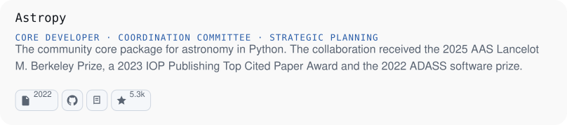
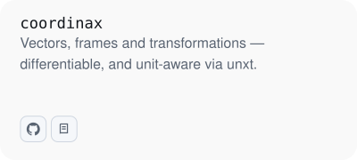
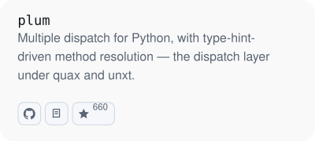
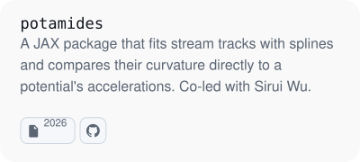
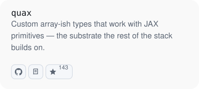
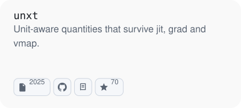

I am a computational astrophysicist studying dark matter: what it is, and how it is distributed in galaxies. I measure it mostly with stellar streams, in the Milky Way and, with large surveys, in thousands of galaxies beyond it.

When a star cluster or dwarf galaxy is pulled apart by its host galaxy, its stars spread out into a long, thin stream. The stream’s path, width and density depend on the host’s gravitational field, including its dark matter. I develop statistical and machine-learning methods to find streams, model them and infer that field, and I write much of the open-source software these analyses run on. I am also a core developer of Astropy, the community Python library for astronomy, where I lead the cosmology module and serve on the Coordination Committee.

### 🔗 Links

✉️ starkman [at] mit [dot] edu &nbsp;|&nbsp; 🌐 [nstarkman.space](https://nstarkman.space)

 [**Publications**](https://ui.adsabs.harvard.edu/search/q=author%3A%22Starkman%2C%20Nathaniel%22&sort=date%20desc) &nbsp;|&nbsp;  [**arXiv**](https://arxiv.org/a/starkman_n_1) &nbsp;|&nbsp;  [**Zenodo**](https://zenodo.org/search?q=%22Starkman%2C%20Nathaniel%22) &nbsp;|&nbsp;  [**ORCID** 0000-0003-3954-3291](https://orcid.org/0000-0003-3954-3291) &nbsp;|&nbsp; 🎓 [**Google Scholar**](https://scholar.google.com/citations?user=WxfvklgAAAAJ) &nbsp;|&nbsp; 🐙 [**GitHub**](https://github.com/nstarman)

### 📄 Select Publications

> 📄 paper · 🔨 paper repo · 💻 code · 📖 docs · 🗄️ data

1. **N. Starkman**, J. Nibauer, S. Pearson, S. Wu, et al. (2026). *When Streams Curve Away: a Test of Dark Matter from Extragalactic Stellar Stream Populations.* The Astrophysical Journal. *submitted.*&nbsp;&nbsp;[🔗](https://github.com/nstarman/paper-stream-convexities-1 "syw") [🔗](https://nstarkman.space/paper-stream-convexities-1/ "homepage") [📄](https://ui.adsabs.harvard.edu/abs/2026arXiv260940057S/abstract "ADS")
1. Euclid Collaboration, **N. Starkman**, J. Nibauer, S. Pearson, S. Wu, et al. (2026). *Euclid Quick Data Release (Q1): The geometry of dark matter halos from extragalactic streams.* Astronomy & Astrophysics. *submitted.*&nbsp;&nbsp;[📜](https://arxiv.org/abs/2606.21774 "preprint") [📄](https://ui.adsabs.harvard.edu/abs/2026arXiv260621774E/abstract "ADS")
1. C. Myers, **N. Starkman**, L. Necib (2026). *Reconstructing Galactic Gravitational Potentials from Stellar Kinematics with Physics-Informed Neural Networks.* The Astrophysical Journal. *submitted.*&nbsp;&nbsp;[💻](https://github.com/charlottemyers/galactoPINNs "code") [📄](https://ui.adsabs.harvard.edu/abs/2026arXiv260618386M/abstract "ADS")
1. **N. Starkman**, A. M. Price-Whelan, J. Nibauer (2025). *unxt: A Python package for unit-aware computing with JAX.* Journal of Open Source Software 10, 7771.&nbsp;&nbsp;[📄](https://doi.org/10.21105/joss.07771 "paper") [💻](https://github.com/GalacticDynamics/unxt "code") [📖](https://unxt.readthedocs.io/en/stable/ "docs") [📄](https://ui.adsabs.harvard.edu/abs/2025JOSS...10.7771S/abstract "ADS")
1. **N. Starkman**, J. Nibauer, J. Bovy, J. Webb, et al. (2025). *Stream Members Only: Data-Driven Characterization of Stellar Streams with Mixture Density Networks.* The Astrophysical Journal 980, 253.&nbsp;&nbsp;[📄](https://iopscience.iop.org/article/10.3847/1538-4357/ad94f2 "paper") [🔗](https://github.com/nstarman/stellar_stream_density_ml_paper "syw") [🗄️](https://zenodo.org/records/10211410 "data") [📄](https://ui.adsabs.harvard.edu/abs/2025ApJ...980..253S/abstract "ADS")
1. **N. Starkman**, G. Starkman, A. Kosowsky (2024). *Angular Correlations of Cosmic Microwave Background Spectrum Distortions from Photon Diffusion.* Monthly Notices of the Royal Astronomical Society 529, 2274–2288.&nbsp;&nbsp;[📄](https://academic.oup.com/mnras/article/529/3/2274/7630233 "paper") [🔗](https://github.com/nstarman/Temperature-Diffusion-Spectral-Distortion-Paper "syw") [🗄️](https://zenodo.org/record/8400583 "data") [📄](https://ui.adsabs.harvard.edu/abs/2024MNRAS.529.2274S/abstract "ADS")

➡️ Full publication list on [**ADS**](https://ui.adsabs.harvard.edu/search/q=author%3A%22Starkman%2C%20Nathaniel%22&sort=date%20desc).

### 💻 Software

<a href="https://www.astropy.org"><picture><source media="(prefers-color-scheme: dark)" srcset="assets/cards/astropy-dark.svg"></picture></a>

<a href="https://coordinax.readthedocs.io"><picture><source media="(prefers-color-scheme: dark)" srcset="assets/cards/coordinax-dark.svg"></picture></a>
<a href="https://galax.readthedocs.io"><picture><source media="(prefers-color-scheme: dark)" srcset="assets/cards/galax-dark.svg"></picture></a>

<a href="https://beartype.github.io/plum/"><picture><source media="(prefers-color-scheme: dark)" srcset="assets/cards/plum-dark.svg"></picture></a>
<a href="https://github.com/xggs-dev/potamides"><picture><source media="(prefers-color-scheme: dark)" srcset="assets/cards/potamides-dark.svg"></picture></a>

<a href="https://nstarman.github.io/quax/"><picture><source media="(prefers-color-scheme: dark)" srcset="assets/cards/quax-dark.svg"></picture></a>
<a href="https://unxt.readthedocs.io/en/stable/"><picture><source media="(prefers-color-scheme: dark)" srcset="assets/cards/unxt-dark.svg"></picture></a>

